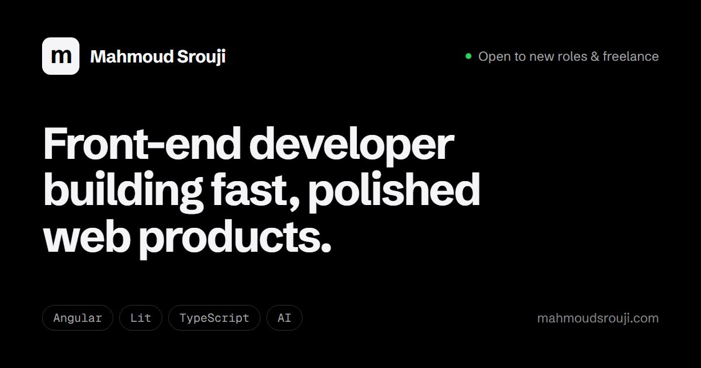

### Hi, I'm Mahmoud

Front-end developer in Lebanon. I build fast, accessible interfaces with **Angular**, **Lit** and **TypeScript**, ship bilingual products (English + Arabic with full RTL), and build AI chat interfaces.

- Most recently built UI for **Synopsys** engineering platforms at Silicon Cedars, with Lit web components shared across many internal apps.
- Built and run **[Java Assistant](https://javaassistant.com)**, a tutoring platform used across several countries and universities.
- Author of **[ai-chat-element](https://www.npmjs.com/package/ai-chat-element)** on npm.
- Open to **full-time roles** and **freelance projects**.

### Featured work

| Project | What it is | Built with |
| --- | --- | --- |
| **[Java Assistant](https://javaassistant.com)** | Multi-country tutoring and solving platform: role-based dashboards, real-time chat, ratings, EN/AR with RTL | Angular · PrimeNG · Firebase |
| **[ai-chat-element](https://github.com/MahmoudSr/ai-chat-element)** | Framework-agnostic AI chat UI as a Web Component, with streaming and OpenAI / Anthropic adapters | Lit · TypeScript · npm |
| **[fastdl](https://github.com/MahmoudSr/fastdl)** | Open-source multi-connection download manager with a browser extension | Tauri · Rust · JavaScript |
| **[FabriKit](https://fabrikit.store)** | Custom Shopify storefront with an illustrated, animated intro | Shopify · Liquid |
| **Ali Srouji** | Cinematic filmmaker portfolio with a 3D camera intro | Three.js · GSAP · Vite |

More on my **[portfolio](https://portfolio-neon-delta-42.vercel.app/projects)**.

### Tech

### Contact

